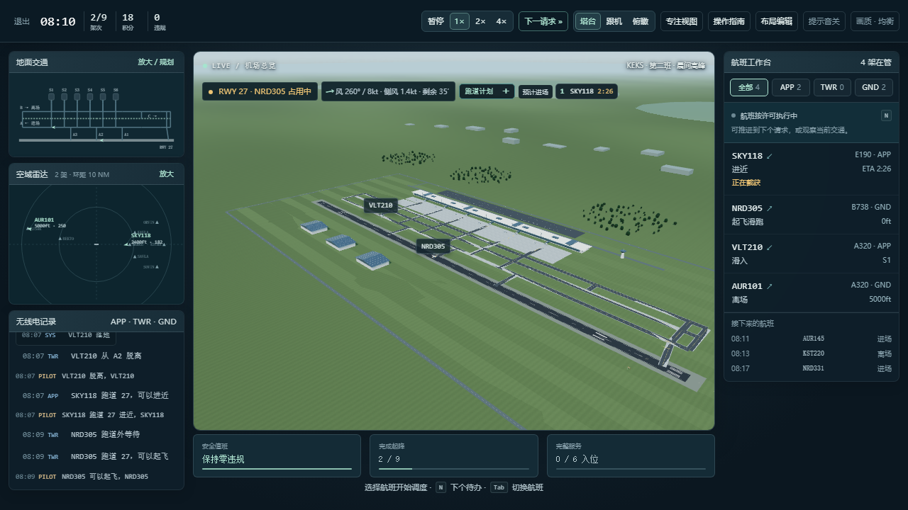

# Kestrel Approach

[](https://github.com/starlake4G/atc-sim/actions/workflows/deploy.yml)
[](LICENSE)

> 浏览器里的全流程机场管制（ATC）游戏 · A full-loop air traffic control game that runs in your browser.

**在线试玩**：[https://starlake4G.github.io/atc-sim/](https://starlake4G.github.io/atc-sim/)（免安装，打开即玩；由 GitHub Actions 自动构建部署）

3D 机场主视图、地面路线工作台、空域排序、席位移交与班次复盘共用同一套确定性仿真状态：画面、地图和回放都由同一个 10Hz 仿真内核驱动。



## 特性

- **全流程管制**：进场引导 → ILS 进近 → 落地许可 → 脱离 → 联系地面 → 滑入机位；推出 → 滑行许可 → 跑道外等待 → 起飞 → 移交离场。
- **安全守卫**：跑道物理占用互锁、落地预留、尾流间隔、起飞窗口余量；非法许可会被拦截并直接说明原因。
- **跑道计划与试排**：拖动调整进离场顺序，比较预计占用窗口与延误；未承诺航班可先无副作用预览交换结果，再决定是否采用。
- **运行事件**：跑道例行检查与阵风天气提前预告，可主动「利用空档」提前安排；侧风按跑道方向和机型分级限制。
- **8 个班次 + 种子挑战**：从单机教学、地面放行到高峰波次、三向合流；同种子重现同一班表，最好成绩按种子与规则版本分别保存。
- **复盘与回放**：按完成量、安全与延误评级，逐航班延误归因，调度操作可逐条回放并导出 JSON 记录。
- **辅助 / 标准双模式**：辅助模式自动处理常规滑行，标准模式完整手动管制，适合上手后进阶。
- **数据驱动内容**：机场与关卡全部是数据文件，加内容不用改引擎，见 [内容制作指南](docs/CONTENT-GUIDE.md)。

## 快速开始

需要 Node.js 20+。

```bash
git clone https://github.com/starlake4G/atc-sim.git
cd atc-sim/atc-sim
npm install
npm run dev        # http://localhost:5173
```

开发服务器同时监听 `0.0.0.0`：同一局域网的手机或另一台电脑访问 `http://<本机IP>:5173` 即可（Windows 需放行 node.exe 的专用网络入站）。

```bash
npm run build      # 类型检查 + 产物输出到 atc-sim/dist/
npm run preview    # 本地预览构建产物
```

## 测试

```bash
npm run accept     # 类型检查 + 8 组无头逻辑回归（108 项），无需浏览器
npm run ui:test    # 浏览器端到端回归，需本机 Chrome/Edge，先另开终端 npm run dev
```

单组回归脚本（`sim` / `gameplay` / `planning` / `challenge` / `edge` / `experience` / `operations` / `decisions`）及其 UI 回归的说明见 [atc-sim/README.md](atc-sim/README.md)。

## 操作速查

| 操作 | 说明 |
|---|---|
| 点击飞机 / 标牌 / 右侧列表 | 选中航班 |
| E / N | 下达当前高亮许可 / 选择下个待办航班 |
| 空格 · 1 / 2 / 4 | 暂停 / 时间倍速 |
| F1 / F2 / F3 | 塔台（全场）/ 跟机 / 俯瞰 |
| V | 专注视图（扩大 3D 画面，保留待办与许可） |
| 滚轮 / 拖拽 | 缩放 / 环绕视角 |

完整玩法、指令条规则与调试参数见 [atc-sim/README.md](atc-sim/README.md)。

## 架构

```
atc-sim/src/sim/     纯逻辑仿真：10Hz 定步长、确定性，禁止 import three/react
atc-sim/src/data/    机场与关卡数据
atc-sim/src/views/   three.js 3D 场景
atc-sim/src/ui/      React 界面
atc-sim/scripts/     无头回归测试与截图脚本
docs/                设计文档、路线图与竞品分析
```

仿真与渲染、界面严格分层：实时游玩、快进和回放走同一条仿真路径，回放能精确重建每一局的调度操作。技术栈为 Vite、React 19、three.js 与 TypeScript（严格模式）。

## 文档

- [玩法与开发手册](atc-sim/README.md) —— 全部操作、玩法系统、调试参数与测试矩阵
- [内容制作指南](docs/CONTENT-GUIDE.md) —— 新增机场 / 关卡
- [成品试玩版路线图](docs/ATC-RELEASE-ROADMAP.md) —— 下一阶段计划
- [可玩性方案](docs/ATC-PLAYABILITY-PLAN.md)、[竞品扫描](docs/ATC-COMPETITOR-SCAN.md)

## License

[MIT](LICENSE) © 2026 starlake4G
